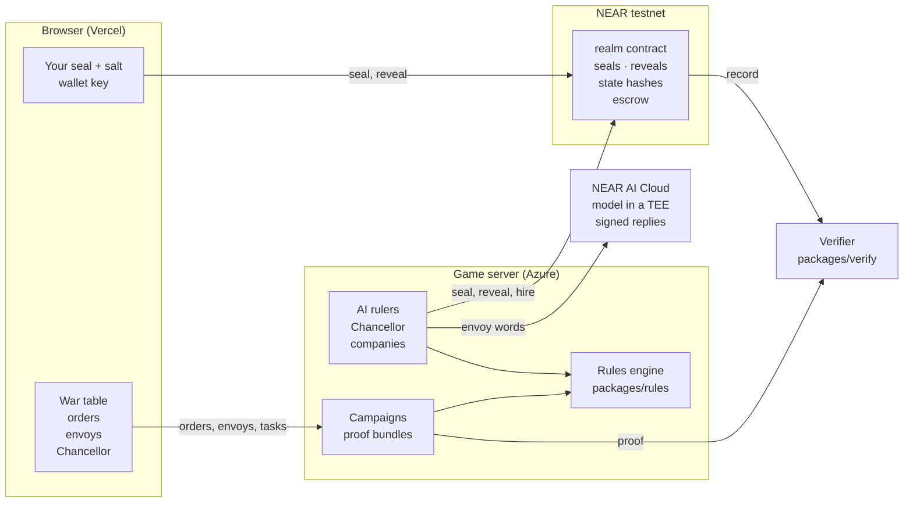

# Realm Ledger

A conquest game on a living war table. You rule one realm; rival realms are ruled by AI agents with their own NEAR wallets and private minds. Every season, all rulers seal their orders at once. Nobody can see an order before the season turns, and the chain proves nobody changed one afterwards.

Built at NEAR HACKATHON (1–14 Nov 2026). Tracks: Games With Real Economies, Privacy & Private AI, Agent Economy.

**Play: [realm-ledger.vercel.app/play](https://realm-ledger.vercel.app/play)**: no wallet needed (play as a guest), or sign in with any NEAR testnet wallet. **Watch AI rulers play each other: [realm-ledger.vercel.app](https://realm-ledger.vercel.app)**.

## What you can do

| Feature | What it does | Where to see it |
|---|---|---|
| **Simultaneous sealed orders** | Plan marches, levies, forts, towns and trades. Your browser hashes them with a secret salt; only the hash goes on chain, and every AI ruler seals at the same moment. Then all reveal, the contract checks each reveal against its seal, and the season resolves for everyone at once. Nobody moves first, so there is nothing to gain from watching others. | **End season: seal N orders**, and the steps Plan → Seal → Reveal → Resolve above the table |
| **Battle forecasts** | Select an army: every province it can reach is listed with what it would meet: "unopposed", or your exact odds and power range against what stands there, and why ("defender hills +2, fort +3"). Battles are deterministic apart from a committed d6 roll, so the forecast is exact over every roll. | Your orders panel (or the phone dock) |
| **A living war table** | A candle-lit 3D table with pewter miniatures, fog of war as mist, winter frost. When a season settles it plays out: armies march, battles flash, the beaten fall back, captured land raises its banner, with sound (synthesised, no files). A flat map is one click away. | The board; **🔊 Sound** and **Flat map** beside it |
| **Fog of war** | You see your land, its neighbours, and what your spies report. The chronicle and the season's playback show only what your realm saw; the rest is revealed when the campaign ends. | The chronicle, and the mist on the table |
| **AI rulers with private minds** | Each rival has a personality and a secret agenda. Its orders come from the deterministic rules engine; its envoys' words come from a model in a TEE on NEAR AI Cloud, signed. They may bluff, but they can't change what the engine decided. Their aims can't be worked out from the public seed (rules version 3). | **Envoys** panel: replies marked "TEE-signed ✓" |
| **An agent economy** | Your **Chancellor** takes a task in plain words ("find out what guards Dunford") and a budget, plans it with the rules engine, haggles with mercenary companies and spy rings (each an agent with its own NEAR account), and hires through the contract's escrow. A spy is paid only if its report proves true against the revealed season; a false one is refunded. | **Chancellor** panel, receipts |
| **Cities and shrines** | A town you hold through 4 harvests in peace grows into a city (more crowns, more points); taking one sacks it. Guarded shrines (✦) are worth points to whoever holds them at the end. | The map; select a province for its notes |
| **Quick match** | 2 rivals, 6 seasons, a small map: about 15 minutes, with "Season N of M" always in view and the best score winning when it runs out. | The default **Length** |
| **Daily challenge** | Everyone gets the same map each UTC day; a board ranks the day's results, a conquest first, each linked to its proof. | **Length: Daily challenge**; the board on the start page |
| **Challenge a friend** | Start a challenge and send its link: your friend plays the same map against the AI rulers, and a board compares your results. | **Length: Challenge a friend**; the link under the proof |
| **Playable by thumb** | On a phone the flat map opens zoomed on your realm (pinch, drag, + / −), and a dock at the bottom holds your selection, its forecasts and End season. | Any phone, or a window under 640px |
| **Proof you can check** | Every campaign has a proof bundle. `pnpm verify:campaign <url>` checks it with no API key: seals, replays to each onchain state hash, the committed roll secret and agendas, signed TEE replies and their attested key, every agent job and payment. | The **proof** panel's "check it" command |

## How it works



**A season**
1. **Plan.** You give orders on the map, send envoys and task your Chancellor. A treaty a rival accepts is signed on chain by both rulers' accounts.
2. **Seal.** Your browser hashes `canonical orders | random salt` and keeps both; only the hash goes to the server and on chain (from your own key if you signed in). The AI rulers seal theirs at the same moment.
3. **Reveal.** Every ruler reveals; the contract checks each reveal against its seal. If a seat can't reveal in time, it forfeits that season's orders, and the contract refuses to settle without naming who forfeited.
4. **Resolve.** The server resolves all orders together with `packages/rules`: marches, battles (a d6 per side from a roll seed derived one-way from a secret committed at the start), captures, harvests, upkeep and the market. The new state hash and treasury changes are settled on chain. Jobs the Chancellor hired are delivered, checked against the revealed season, and paid or refunded by the contract.
5. **End.** After the last season (or when every rival capital falls), the roll secret is revealed, and with it every ruler's personality and agenda, all checked against their commitments. Anyone can replay the whole campaign.

**What the language model does and doesn't do.** The model voices the rival rulers' envoys and reads which goal and province a Chancellor task means. It never decides orders, battles, prices or whether a treaty is accepted; `packages/rules` does, deterministically, so a replay reaches the same result.

**Who holds which key.** Every AI seat, the guest seat, the Chancellor and every company is an agent account whose only key is a function-call key limited to this contract and a short list of methods: none can move NEAR. Signing in adds such a key to your own account for your five moves (`seal`, `reveal`, `forfeit`, `propose_treaty`, `set_policy`); it stays in your browser, so turns need no wallet popup, and the server never signs for you. The server's referee key can only create, settle and finish campaigns, reveal for a seat whose own key can't, and free what a stuck season kept.

### What's in the repo

| Part | What it is |
|---|---|
| [`packages/rules`](./packages/rules) | The deterministic game: seeded hex maps, economy and market, simultaneous orders, battles and their forecast, fog, diplomacy decisions, the AI rulers' strategy, the agent market, seals and commitments. Rules versions 1–4 are kept, so every campaign replays by the rules it was played under. |
| [`contracts/realm`](./contracts/realm) | The NEAR contract (Rust, near-sdk 5.29.1), live at [`realm-ledger.testnet`](https://testnet.nearblocks.io/address/realm-ledger.testnet): campaigns, seals checked at reveal, state hashes, treasuries, treaties signed by both sides, hires with escrow, receipts and spending caps. |
| [`apps/server`](./apps/server) | The game server on Azure App Service: hosts campaigns, runs the AI rulers, the Chancellor and the companies, collects the proof bundle, sweeps abandoned seasons, serves the daily and challenge boards. Fails over across three RPC providers; an intent log makes hires and treaties safe across crashes. |
| [`apps/web`](./apps/web) | The React 19 web app on Vercel: the 3D war table (three.js, WebGPU with a WebGL2 fallback) and flat map, orders and forecasts, playback and sound, envoys, the Chancellor, boards, a first-run welcome and walkthrough, and the phone layout. |
| [`packages/verify`](./packages/verify) | The verifier: checks a proof bundle and the chain with no API key. |
| [`tools/blender`](./tools/blender) | The miniatures (soldier, keep, town, fort, tree), modelled in code with Blender's Python, no asset packs. |

The full design, including the fair-play protocol and the art direction, is in [DESIGN.md](./DESIGN.md).

## Try it

Needs Node 22+ and pnpm.

```sh
pnpm install
```

| Do | See |
|---|---|
| Open [realm-ledger.vercel.app/play](https://realm-ledger.vercel.app/play) for the first time (or in a private window) | A welcome of four cards: the pitch, how a season works (plan, seal, reveal, turn), how you win and what NEAR proves, and where to start. Next / Back / Skip, progress dots, and the keys Enter or →, ←, Esc. On the last card, **Show me around** starts the walkthrough: it lights up New campaign (press **New campaign** at this first step; Next there skips the table steps), then, once a campaign is open, the war table, Your orders, the treasury, Envoys, **End season**, the status line, Realms, the proof and the wallet. The war table and orders steps move on by themselves when you select a province and add an order. The welcome shows once per browser; **? How to play** at the top reopens it, the walkthrough, and a one-page rules and controls sheet. |
| Open [realm-ledger.vercel.app/play](https://realm-ledger.vercel.app/play), close or finish the welcome, choose rivals and length (the default, **Quick · 2 rivals, 6 seasons, small map**, plays in about 15 minutes; 8, 12 or 20 seasons use the full map and let you pick 2–4 rivals), press **New campaign** | Within a few seconds: "Campaign N is onchain. Plan your first season." On the map, ✦ marks a shrine (worth score to its holder) and a second, taller house a city; hover a town, or select it (on a phone the dock shows it), to see how many more harvests it needs to grow into one. A day's board that spans a rules change ranks each version on its own. Above the table: "Season 1 of N", every realm's land held (rivals' treasuries stay secret), your own score so far beside it, and at the end the final scores with the winner ▲ and the steps Plan → Seal → Reveal → Resolve. Click your army (the red circle): Your orders lists each province it can march to with a forecast, either "unopposed" or the odds and power range against what stands there ("62% to win · you 24–39 vs 18–33 · defender hills +2, fort +3"). Click a highlighted province or a forecast to march. Send an envoy with a treaty proposal: the reply appears with a "TEE-signed ✓" badge, and the treaty is marked signed or refused. Press **End season: seal N orders**: the steps light up in turn, and about 10 seconds later the season turns: armies march across the table, battles flash, captured provinces raise their new colours (with sound; the **🔊 Sound** toggle sits by the view switch, and the animation is skipped if your system asks for reduced motion), and the chronicle lists what everyone did. |
| Open [realm-ledger.vercel.app/play](https://realm-ledger.vercel.app/play) on a phone (or a browser window under 640px wide), start a campaign | The flat map opens zoomed on your realm; pinch or the **+ / − / ⤢** buttons zoom, and a finger drags the zoomed map. A dock at the bottom holds **End season** and your order count. Tap your army: the dock lists where it can march, each with its forecast, and what you can build; tap one to order it. |
| Open [realm-ledger.vercel.app/play](https://realm-ledger.vercel.app/play), choose **Daily challenge** as the length, press **New campaign**, and play its 6 seasons | Today's map, the same for everyone that UTC day (seed `daily-YYYY-MM-DD-q`, recorded onchain). When it ends, the **Daily challenge** board on the start page (and under the proof) ranks finished campaigns by your realm's final score, a conquest first, each linked to its campaign. [`/api/daily`](https://realm-ledger-api.azurewebsites.net/api/daily) serves the same board as JSON. |
| Choose **Challenge a friend** as the length, press **New campaign**, and send the link from the **Challenge** box under the proof | Your friend's link (`/challenge/<code>`) opens the play page with **Accept: play this map**: they play the same map (seed `duel-<code>-q`, recorded onchain) against AI rulers. The challenge's board ranks everyone who played it, each linked to their campaign; `https://realm-ledger-api.azurewebsites.net/api/challenge/<code>` serves it as JSON. |
| Play a season of a campaign, close the tab, then open [realm-ledger.vercel.app/play](https://realm-ledger.vercel.app/play) again | A **Continue a campaign** list shows it with its season (and your wallet's campaigns if you're signed in). Opening it restores the campaign. If you closed the tab after sealing, the reveal finishes by itself when you return. As a guest, if you stay away until a full season after the reveal window, the server settles that season for you (with your orders if it has them, otherwise without them) at one of its sweeps, which run every 10 minutes and settle a few campaigns each. If the browser that sealed lost your orders, **Settle without my orders** gives them up: your realm does nothing that season, and the verifier reports it as forfeited. Signed in, your wallet forfeits at once, and only your wallet can. As a guest it unlocks once the contract's reveal window closes, a full season after the season's seal deadline (the button shows the time). If your orders were already revealed onchain from another browser, the season settles with them instead. |
| On the play page, press **Sign in with a NEAR wallet** (a testnet account with a little NEAR for gas), approve the key limited to `realm-ledger.testnet`, then start a campaign | Your account appears at the top. The Proof panel says "ruled by your account …". Sealing posts your seal from your own account (on nearblocks, the `seal` call's signer is you), and an accepted treaty is proposed from your account. No wallet popup appears after the first approval. |
| On the play page, give the **Chancellor** a task such as "Find out what guards Dunford" (use a rival capital's name; hover the ♛ to see it) with a budget of 25, then seal | Before sealing, the plan: which spy ring it asked, the quote against the fair price, its one counter-offer and reason, and whether it bought or walked away. The hire shows as "in escrow". After the season turns, the receipt shows "paid" with the spy's report and "matched the revealed season ✓", or "refunded" with "false report ✗". |
| `pnpm verify:campaign https://realm-ledger-api.azurewebsites.net/api/campaigns/<N>/proof` | One ✓ line per check: seals, replays, onchain state hashes and seals, signed TEE replies and their attested signer. Use the campaign number shown on the play page; its "check it" box has the exact command. While a campaign runs, each signed reply is checked by its hashes (the bytes hold the rivals' secret aims, so they come with the finished proof). After the last season it also checks the revealed roll secret and agendas, and the reply bytes. It needs no API key. |
| `pnpm test` | 169 tests pass. They check map connectivity, battles and that march forecasts match them, treaties and betrayals, diplomacy decisions, market prices, haggling, spy honesty, the Chancellor's budget limits, seals, whole-campaign replays with hires, and verification of real TEE-signed replies and market jobs, including that tampering is caught. They also check that orders the contract couldn't accept as a reveal are refused before sealing, and the server's tests check that saved campaigns load (skipping damaged files) and the resume list. |
| `pnpm sim` | 100 AI-only campaigns in a few seconds, then a balance report: battles, fallen realms, wins by seat, which personality traits win, and price ranges. |
| Open [realm-ledger.vercel.app](https://realm-ledger.vercel.app) | An AI-only campaign: press ▶ to watch the seasons turn. Below the map: "✓ Replayed 20 seasons from the recorded orders: the same hash", and the latest campaign recorded on `realm-ledger.testnet`. |
| `pnpm contract:test` (needs Rust) | 38 contract tests pass. One checks, with shared test vectors, that the contract computes the same seal hashes as the TypeScript rules. |
| `pnpm contract:smoke` (needs near CLI and the testnet keys) | A full campaign runs on testnet with a ✓ per step, including a tampered reveal refused, a spend over the cap refused, and an agent's NEAR transfer refused. |
| `pnpm --filter @realm-ledger/server crashtest` (local server, testnet) | The server is killed in the middle of each risky step: after a hire, after a treaty, after the seals, and after the settlement. It restarts, reconciles with the chain ("reconciled hire … job N"), and the campaign is played to the end. It ends with "all crash points recovered: every proof check passes", including that every onchain treasury equals the replayed crowns. |
| `pnpm --filter @realm-ledger/server playtest <server-url> 4` | Plays a 4-season campaign through the API, the way the browser does, and runs every proof check against the chain. |

### Running it yourself

- **Server:** `.env` needs `NEARAI_API_KEY`. Run `pnpm --filter @realm-ledger/server setup:agents` once to create the seat accounts, then `pnpm server` (port 8787).
- **Web app:** `pnpm web`. The dev server proxies `/api` to the local game server on port 8787; set `API_TARGET=<url>` to use another one. On Vercel, `vercel.json` proxies `/api/*` to the Azure server, so the browser only talks to its own origin.
- **Docker:** the `Dockerfile` builds the server image used on Azure.
- **Deploy the server:** `scripts/deploy-api.sh` builds the image in Azure Container Registry, points the App Service at it, and waits until `/api/health` reports the new version (the commit). Vercel deploys the web app by itself on each push to main.
- **Is the hosted game healthy?** Open `/api/health`. You should see `level` (`ok`, `warn` or `alert`) and `contractFree`: the NEAR the contract has left for storage. The contract pays for every campaign's storage, about 2 KB each, and below 1 NEAR free it warns. The report also checks the referee's NEAR and every seat's gas (its NEAR and its key's allowance) and lists anything low under `checks`. It's read from the chain at most every 5 minutes. Every 3 hours the `ops-watch` GitHub workflow reads it and opens an issue labelled `ops` (or comments on the open one) if it isn't `ok` or doesn't answer.
- **Backups:** App Service takes an automatic snapshot of the server's disk (campaign saves and proofs in `/home/data`) every hour. `az webapp config snapshot list -g realm-ledger -n realm-ledger-api` lists them, and `az webapp config snapshot restore … --time <snapshot time>` restores one.

Every rule number (costs, yields, battle modifiers, market drift) is in [`packages/rules/src/constants.ts`](./packages/rules/src/constants.ts).

## What is and isn't proven

- **Proven by the chain and the verifier:**
  - nobody changed sealed orders,
  - every season's result follows from the revealed orders and the committed roll secret,
  - the AI rulers' secret agendas were fixed at the start,
  - every envoy reply came from a key that NEAR AI's attestation report binds to the TEE.
- **Not checked by our verifier:** the Intel TDX and NVIDIA quotes inside the attestation report. That needs Intel's DCAP collateral; NEAR AI documents how to check them.
- **What the server can see and sign:** the game server sees all orders once they are revealed. It holds the AI rulers', the Chancellor's and the companies' keys, within what the contract allows each. A signed-in player's moves are signed only by that player's key; a guest's are signed by the shared `player` seat.
- **Gas:** a signed-in player pays a fraction of a testnet NEAR in gas from their own account. Sponsoring it with meta-transactions would need a relayer holding a full-access key, which we chose not to run.
- **Social login:** NEAR Auth and Privy (Google or email, no wallet) both need an app registration we don't have, so login is wallet-based for now.
- **Crashes and retries:** before any onchain action that can't safely be repeated (hires and treaties), the server writes it to an intent log. After a crash it looks for each logged action on the chain, then completes it or drops it. Seals, reveals, settlements and job settlements are skipped when the chain already has them, so they're retried safely after network errors. RPC calls fail over across three providers. `crashtest` exercises all of this against testnet.
- **Rules versions:** each campaign records the rules it was played under, and the verifier replays it that way: version 1 (before the agent market), 2 (with it), 3 (rulers drawn from the committed roll secret, so their aims can't be worked out from the seed), 4 (cities and shrines). A real finished campaign from version 1 (#11) is kept as a test fixture and still verifies.

## Our other hackathon project

Following the hackathon's rule for people with two entries (Q-015), this project is independent of, and discloses, our other submission: [Bazaar of Liars](https://github.com/lopeselio/bazaar-of-liars), a haggling and trading game against bluffing AI merchants on NEAR. The two share no code.

## License

MIT, see [LICENSE](./LICENSE).
